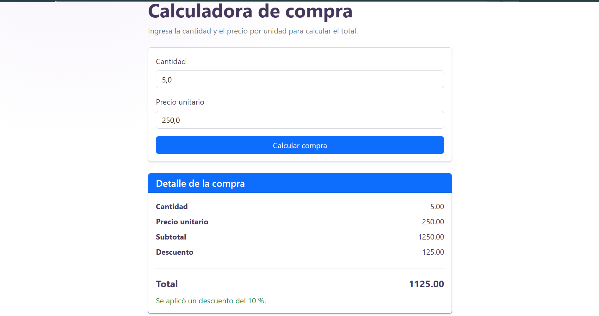
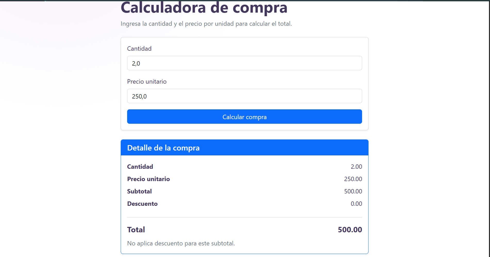
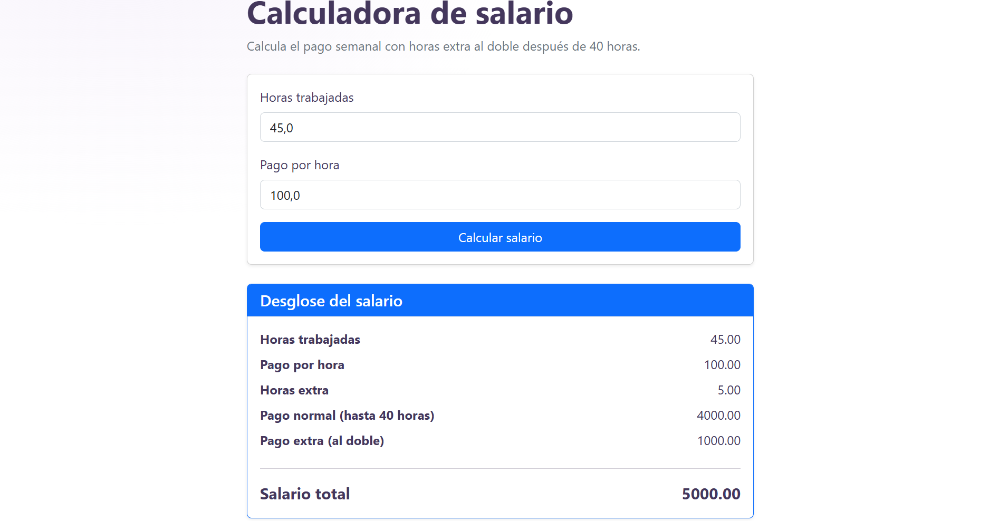
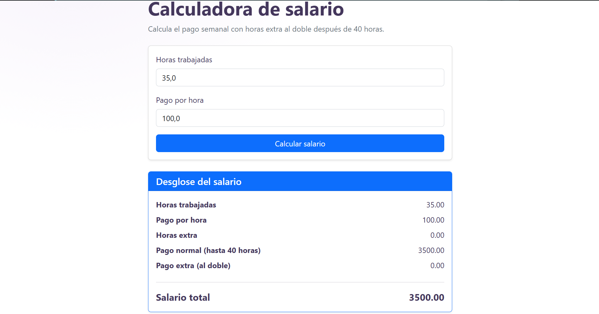
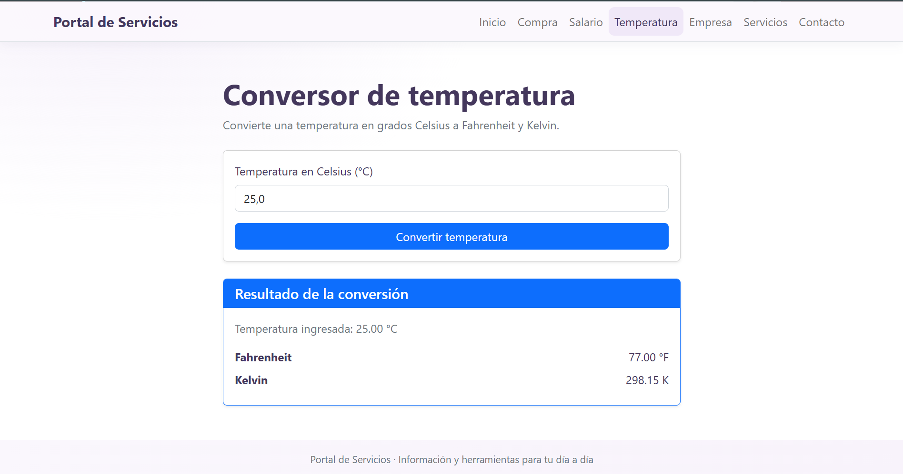

## Evidencias

Interpretación: El subtotal supera los 1000, por lo que se aplica un descuento del 10 % y se muestra el total actualizado.

Interpretación: Como el subtotal no supera los 1000, el descuento es 0 y el total corresponde al subtotal.

Interpretación: Las primeras 40 horas se pagan a tarifa normal y las horas adicionales al doble; el salario total suma ambos pagos.

Interpretación: Al trabajar 40 horas o menos, no se generan horas extra y el salario corresponde al pago normal.

Interpretación: Se muestra la temperatura ingresada en Celsius y su conversión a Fahrenheit y Kelvin.
